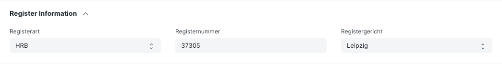
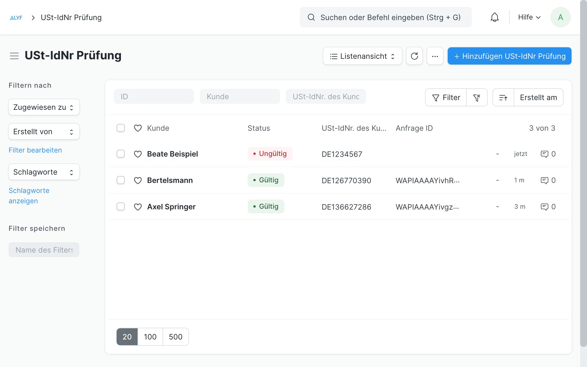

## ERPNext Germany

App to hold regional code for Germany, built on top of ERPNext.

### Features

- German accounting reports

    - _Summen- und Saldenliste_
    - _Zusammenfassende Meldung_

- Section for Register Information (Registerart, -gericht und nummer) in **Company**, **Customer** and **Supplier**

    

- Validation of EU VAT IDs

    Automatically checks the validity of EU VAT IDs of all your customers every three months, or manually whenever you want. Check out the [intro on Youtube](https://youtu.be/hsFMn2Y85zA) (german).

    

- Allow deletion of the most recent sales transaction (per naming series and company) only

    This ensures consecutive numbering of transactions. Applies to **Quotation**, **Sales Order**, **Sales Invoice**.

- Restrict deletion of attachments to submitted transactions
- Custom fields in **Employee** (tax information, etc.)
- List of religios denominations ("Konfessionen")
- List of German health insurance providers (depends on HRMS)
- Create **Business Letters** from a template and print or email them to your customers or suppliers
- Record **Business Trips** and pay out allowances to your employees (dt. Reisekostenabrechnung) (depends on HRMS)
- Hand over your data to the tax office in machine-evaluable form (**GDPdU Export**)
- Set up German VAT (domestic, EU businesses, non-EU countries, small business) with a few clicks, see [Tax Setup](#tax-setup)

## Installation

> [!NOTE]
> Some features of this app depend on the [HRMS](https://github.com/frappe/hrms) app. If you want to use them, you need to install the HRMS app before installing this app.

### On Frappe Cloud

You can find ERPNext Germany in the [Frappe Cloud Marketplace](https://frappecloud.com/marketplace/apps/erpnext_germany).
Please refer to the [Frappe Cloud documentation](https://frappecloud.com/docs/installing-an-app) on how to install an app.

### Local

Using bench, [install ERPNext](https://github.com/frappe/bench#installation) as mentioned here.

Once ERPNext is installed, add the ERPNext Germany app to your bench by running

```bash
bench get-app https://github.com/alyf-de/erpnext_germany.git
```

After that, you can install the app on required site (let's say demo.com ) by running

```bash
bench --site demo.com install-app erpnext_germany
```

## Business Trip

Before an employee can create a **Business Trip (Dienstreise)**, you should configure the available regions and their travel allowances in the **Business Trip Region** list. A basic list based on the German tax law is imported on installation, but not further updated later. In the **Business Trip Settings (Dienstreise-Einstellungen)** you can set the value for the mileage allowance and select **Expense Claim Type** for mileage allowance and **Additional meal expenses**. Both Expense Claim Type are preset to **Additional meal expenses**. If you have HRMS installed, it allows you to book expenses as Expense Claims.

When a **Business Trip** is submitted, it creates a draft **Expense Claim** for the employee's travel allowances including the Additional meal expenses as well as mileage allowance for "Car (private)". One business trip will create on **Expense Claim** which can be approved and submitted as usual.

Mileage allowance is calculated based on the distance entered in the details of the journey when "Car (private)" is selected.

The Additional meal expenses depend on the selected region. Select the "From" and "To" dates of the trip and with the click on "Add Row" all days of the trip a pre-created.

The receipts for transport and accommodation can be attached, but are not processed automatically. You can check them, create a **Purchase Invoice** and pay the respective amount to the employee.

You can use our [Banking app](https://github.com/alyf-de/banking) to reconcile the **Expense Claims** and **Purchase Invoices** with the respective **Bank Transactions**.

## Tax Setup

In **ERPNext Germany Settings**, click _Set up Taxes_ to create a German VAT setup for one company. It uses standard ERPNext features only.

- **Tax Category** describes the business partner: "Inland", "EU Unternehmen (Reverse Charge)", "Drittland". Set it on the **Customer** or **Supplier** (or **Address**). Without one, invoices get no taxes. The setup turns on _Warn if Tax Category is missing_ in **ERPNext Germany Settings**, which then warns on customers, suppliers, sales and purchase invoices without one. Turn it off if you work without Tax Categories.
- **Item Tax Template** is the tax key of an invoice line, for sales and purchases: the rate per tax account, and for e-invoices the VAT category and exemption reason. Created: "Inland Standard", "Inland Ermäßigt", "Steuerfrei", "Innergemeinschaftliche Lieferung/Erwerb Standard / Ermäßigt / Steuerfrei", "Reverse Charge Leistung EU Standard / Ermäßigt", "Ausfuhrlieferung/Einfuhr" and "Leistung Drittland Standard / Ermäßigt / Steuerfrei". Cross-border sales are 0 % at any rate, but on purchases you owe VAT at the item's rate (intra-EU acquisition, § 13b), hence one template per rate.
- **Item Group** rows pick the key per Tax Category. You assign a tax class to an Item Group, e.g. "Ware Standard" or "Leistung Ermäßigt", and subgroups inherit it. Goods from or to an EU business then get "Innergemeinschaftliche Lieferung/Erwerb Standard", services "Reverse Charge Leistung EU Standard".
- **Sales Taxes and Charges Template**, **Purchase Taxes and Charges Template** and **Tax Rule** per Tax Category. The templates pick the accounts of their side; the rate comes from the line's Item Tax Template, so the sales accounts in an Item Tax Template don't matter on purchases and vice versa. Purchase templates add input VAT and deduct the VAT you owe yourself (intra-EU acquisition, § 13b). A line without an Item Tax Template falls back to 19 %, so a gap in the setup shows up as too much VAT instead of none.

Exceptions on an Item or Item Group need rows for every Tax Category: for a missing one ERPNext falls back to the parent Item Group, e.g. a service item in a goods group would get the goods template for EU customers. ERPNext Germany warns when the rows cover only some of the Tax Categories used in your Tax Rules.

Presets:

- _Simple_: domestic business only. Creates the Tax Category "Inland" with 19 % and 7 % per Item Group.
- _Standard_: additionally EU businesses (intra-EU supplies and acquisitions, reverse charge for services) and non-EU countries (exports, imports, services abroad).
- _Kleinunternehmer_: small businesses under § 19 UStG that charge no VAT, see below.

You can add EU businesses or non-EU countries later by running the setup again. For SKR03 and SKR04 the tax accounts are found by account number, otherwise select them in the dialog. Leave the purchase accounts empty to set up sales taxes only. Accounts without an account type (ERPNext creates some German VAT accounts that way) get the type "Tax", which Item Tax Templates require. Import VAT is not covered: it is paid to customs, not on the supplier's invoice.

Small businesses (_Kleinunternehmer_) charge no VAT, so items and accounts play no role. This preset creates one **Sales Taxes and Charges Template** "Kleinunternehmer" without tax rows and a **Tax Rule** that applies it to every customer without a **Tax Category**. Its _Tax Exemption Reason_ "Gemäß § 19 UStG wird keine Umsatzsteuer berechnet." is printed on the invoice. With eu_einvoice, the template gets the VAT category "E", and the e-invoice takes the exemption reason from the invoice's _Tax Exemption Reason_.

_Preview_ lists what would be created without writing anything. The setup only creates what is missing: existing records are never changed, conflicts are listed for you to check. You can adapt everything afterwards and run it again.

With [eu_einvoice](https://github.com/alyf-de/eu_einvoice) installed, the setup also links the e-invoice codes (VAT category, VATEX) and sets the exemption reason text of each Item Tax Template. The texts are collected on **Quotation**, **Sales Order** and **Sales Invoice** (_Tax Exemption Reason_).

The exemption reason texts are the invoice note required by § 14 Abs. 4 Nr. 8 and § 14a UStG. They are invoice data in German, not translated per user; edit them on the Item Tax Template, e.g. "Steuerschuldnerschaft des Leistungsempfängers / Reverse charge" for foreign customers. "Steuerfrei" is a placeholder: make its text specific to your exemption (e.g. "Steuerfreie Heilbehandlung nach § 4 Nr. 14 UStG") and, if one fits, link the matching VATEX code (e.g. "VATEX-EU-132-1C") in **Common Code**. The setup links no VATEX code to it because § 4 UStG covers several exemptions with different codes.

An e-invoice to a non-EU customer can't contain both goods and services: services there are "not subject to VAT" (category "O"), which EN 16931 doesn't allow next to other categories. Send separate invoices for goods and services, or send such invoices without e-invoice (e-invoicing is mandatory only between businesses established in Germany).

ERPNext's own **Item Tax Templates** "0 %", "7 %" and "19 %" are not used by this setup. You can disable them once no Item or Item Group refers to them.

## Zusammenfassende Meldung

Currently, this report lists all invoices as other service ("S"). If you do triangular transactions ("D") or intra-Community supplies ("L"), you need to manually adjust this column in the CSV file. Automatically determining the service type is planned for a future version.

## GDPdU Export

On demand you have to give the tax office your recording- and retention-relevant data, together with the structural information needed to evaluate them. This follows from section 147 paragraph 6 of the Abgabenordnung and the GoBD in the version of the BMF letter of 11 March 2024.

To prepare a handover:

1. Create a new **GDPdU Export**.
2. Select the _Company_.
3. Set _From Date_ and _To Date_ to the period of the audit. Leave both empty to export every period.
4. Add one row to _Exported DocTypes_ per DocType you want to export.
5. Check _Include Attached Files_ on a row to add the documents attached to it.
6. Submit.

The export runs in the background. When it is done, the ZIP archive is attached to the document and a _Download_ button appears.

The archive holds one CSV file per DocType, the attached files, an `index.xml` that describes them and the DTD that `index.xml` is validated against. A DocType with a business date (`posting_date`, `transaction_date` or `date`) is limited to the selected period. Master data such as **Customer** or **Account** carries no such date and is always exported in full. Cutting it by the period would leave the transactions pointing at rows that are not part of the data set.

`index.xml` is generated from the meta data. A field of type "Link" becomes a foreign key, and a child table becomes a table of its own. Custom fields are exported too, without further configuration.

Ask your tax advisor which DocTypes belong in the handover. The app does not decide the scope for you.

## Quick Start Demo

The fastest way to get a running demo site on your local desktop.

Prerequisites: [Docker](https://www.docker.com/) and [git](https://git-scm.com/) installed on your machine.

```bash
git clone https://github.com/alyf-de/erpnext_germany.git
cd erpnext_germany/docker
cp .env.example .env
docker compose up -d
```

The first setup will take a while. Then you can access the demo site at http://localhost:8000.
Log in with the Username `Administrator` and the default password `admin`.

Read more about the setup in the [docker/README.md](docker/README.md) file.

### Contributing

#### Create a release

Create a temporary release branch based on the current hotfix branch:

```bash
git fetch upstream
git checkout upstream/version-XX-hotfix
git checkout -b version-XX-release
```

Create a PR against the main branch:

```bash
gh pr create --base version-XX --title "chore: release vXX" --body ""
```

If all tests pass, merge the PR using a merge commit (don't rebase or squash). This should automatically delete the release branch and trigger a CI workflow to create a new release.

### License

GNU GPL V3. See the `LICENSE` file for more information.

The file `gdpdu-01-03-2019.dtd` is not part of this app. CaseWare Germany GmbH publishes it at https://www.caseware.com/de/beschreibungsstandard and holds the copyright. The app ships the file unmodified, because the description standard requires it to be handed over next to `index.xml`.
